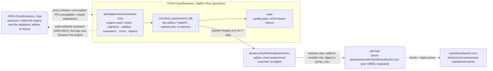

# Hybrid Cloud Works Cloud Assessment

**The lab edition of the Cloud Assessor: assess an Azure Resource Graph export against paraphrased FinOps, Well-Architected cost and Zero Trust criteria, in memory, with no cloud connectivity by design.**

[](https://github.com/saulpatinojr/HCW-CloudAssessor_AddOn/actions/workflows/ci.yml)
[](https://github.com/saulpatinojr/HCW-CloudAssessor_AddOn/actions/workflows/security.yml)
[](https://github.com/saulpatinojr/HCW-CloudAssessor_AddOn/actions/workflows/publish-images.yml)
[](https://github.com/saulpatinojr/HCW-CloudAssessor_AddOn/actions/workflows/core-update.yml)
[](.python-version)
[](docs/deployment/lab-host.md)
[](LICENSE)

Upload the JSON that `az graph query` prints, or the CSV that Resource Graph Explorer downloads, and get a scorecard per
framework and pillar, a findings table with evidence, and a report bundle. The lab **never connects to a cloud, never
asks for credentials and keeps nothing**: an upload is processed in memory, returned only to the browser session that
holds its owner token, and expires after two hours or when deleted. Every scorecard states its coverage, because an
export cannot show spend, budgets, role assignments, diagnostic settings, policy state, Defender plans or traffic, and the
report says so in data (`unknown`), not only in prose. It is not an audit.

**Where to try it.** The pane will appear at [hybridcloudworks.com/tools/cloud-assessment](https://hybridcloudworks.com/tools/cloud-assessment)
once the first image is published; until then, run it on your own machine with the Quick start below and open
`http://127.0.0.1:8080`. Either way there is no account and nothing to install in Azure: you export, you upload, you read.

> **Status:** lab edition, not production. Limitations are recorded in [`VALIDATION.md`](VALIDATION.md). Every criterion's
> reference link is marked `[VERIFY]` until the owner confirms it; the attribution wording awaits owner review
> (`[REVIEW REQUIRED]`, R-005).

## How the pieces relate



The engine was seeded **here** so the lab could ship first, and the App has since adopted it unchanged
([`docs/adr/ADR-0001-lab-edition-upload-only-and-python-engine-seed.md`](docs/adr/ADR-0001-lab-edition-upload-only-and-python-engine-seed.md)).
The App now owns the engine and has released it as `v0.2.0` and `v0.2.1`; this repository has not adopted either yet.
When it pins one of those wheels by URL and hash (a `CORE_REF` line in `pyproject.toml`), it deletes its seed copy, and
`.github/workflows/core-update.yml` brings later releases as pull requests tested against this edition's suites.
What is behind, and the steps to adopt: [`docs/whats-new-upstream.md`](docs/whats-new-upstream.md). Nothing here can reach Azure: `tests/security/test_edition_boundary.py` fails the build
if anything could, and `publish-images.yml` proves `import azure` fails inside the built image.

## Connecting the website

| Concern | Where it is defined |
|---|---|
| The catalogue row (`id: cloud-assessment`), the `/tools/cloud-assessment` route, the status proxy projection, the pane protocol (`hcw-addon` messages, four states), the sandbox and the `downloads` capability request, the environment table, the copy rules | [`docs/website-integration/integration-guide.md`](docs/website-integration/integration-guide.md) |
| The one site route, pre-render and route-inventory entry | [`docs/website-integration/routes.md`](docs/website-integration/routes.md) |
| The API the pane calls (`/api/health`, `/api/config`, `/api/catalog`, `/api/sample.*`, `/api/assessments`, bundle and file downloads, delete) | [`docs/api/openapi.yaml`](docs/api/openapi.yaml) |
| Hosting by the website's `addons` Ansible role: image by digest, env table, port 18083 on loopback, container hardening, the human-verification widget and vault key, Docker Hub publishing | [`docs/deployment/lab-host.md`](docs/deployment/lab-host.md) |
| Threats and controls (in-memory data, owner tokens, limits, fail-closed verification, edition boundary) | [`docs/security/threat-model.md`](docs/security/threat-model.md) |

Only public configuration crosses the boundary: the origin and the verification *site key* are public; the verification
*secret* lives in the lab host's vault (`vault_addon_cloud_assessment_turnstile_secret`), never in the site, Git or
Terraform state.

## Quick start

Requires Python 3.14.6 or newer and [`uv`](https://docs.astral.sh/uv/) 0.11.32 or newer.

```bash
uv python pin 3.14.6 && uv sync --all-packages
uv run pytest -q --cov=packages --cov=src          # unit, contract, security, manifest; coverage gate 85
CA_ALLOW_NO_TURNSTILE=1 PORT=8080 uv run python -m cloud_assessment_lab   # http://127.0.0.1:8080
curl -s http://127.0.0.1:8080/api/health
curl -s -X POST http://127.0.0.1:8080/api/assessments -H 'content-type: application/json' --data-binary @samples/sample-resource-graph.json
```

PowerShell:

```powershell
uv python pin 3.14.6; uv sync --all-packages
uv run pytest -q --cov=packages --cov=src
$env:CA_ALLOW_NO_TURNSTILE = "1"; $env:PORT = "8080"; uv run python -m cloud_assessment_lab
Invoke-RestMethod http://127.0.0.1:8080/api/health
Invoke-RestMethod -Method Post -Uri http://127.0.0.1:8080/api/assessments -ContentType application/json -InFile samples/sample-resource-graph.json
```

`CA_ALLOW_NO_TURNSTILE=1` is for local development and e2e only: without it and without `TURNSTILE_SECRET`, uploads
answer `503 turnstile_not_configured` (fail closed). Browser suite: `make e2e` (Playwright chromium). Container:
`docker compose up` (hardened, loopback-only).

## Repository map

| Path | What |
|---|---|
| [`packages/cloud-assessor-core`](packages/cloud-assessor-core/README.md) | The engine seed (pydantic only): `model.py` (`MODEL_VERSION = 1`), `paths.py`, `ingestion/`, `catalog/` with `criteria.json`, `schema.json`, `scoring.json`, `evaluate/` (six evaluator kinds), `score.py`, `report/`, `redaction.py`, and its tests |
| `src/cloud_assessment_lab` | The lab application: `config.py` (`CA_*`), `edition.py` (import-time guard), `store.py`, `security/` (verification, headers, CORS, limits, rate limit, content-free logging), `routes/`, `app.py`, `__main__.py` |
| `web/` | The pane: `index.html`, `app.js`, `styles.css`, `theme.css` (HCW tokens copied with provenance) |
| `samples/` | 40 fictional rows (subscription `00000000-0000-0000-0000-000000000001`, `hcw-sample-*`, `eastus2`) in three export shapes; results pinned in a test |
| `tests/` | `unit`, `contract` (OpenAPI two-way), `security` (edition boundary, no secrets, content-free logs), `end_to_end` (manifest), `e2e` (Playwright, with a host page that applies the site's sandbox) |
| [`docs/`](docs/README.md) | Website integration, API, lab-host deployment, appliance pointer, runbook, threat model, user guide, bundle, generated criteria catalog, ADRs |
| [`infrastructure/`](infrastructure/README.md) | Dockerfile (two stages, hash-pinned, uid 10001, `HEALTHCHECK`), `versions.env` |
| `scripts/` | `check-catalog.py` (schema drift, link hosts, docs), `package-repository.{sh,ps1}` |

## Releases and artifacts

A `v*` tag builds the image, proves the edition boundary inside it, scans it (Trivy, HIGH/CRITICAL, fixed only), pushes
`docker.io/hybridcloudworks/hcw-addon-cloud-assessment:<version>` with provenance and SBOM, attests it, and prints the
digest in the run summary. The website pins that digest in its lab-host `group_vars`; the digest is the only coupling.
The push is skipped until the owner enables the Docker OIDC connection (`docs/deployment/lab-host.md`).

## What the export cannot show

Spend and forecasts; budgets and cost alerts (not in the `resources` table); role assignments and Entra posture
(`authorizationresources`); diagnostic settings; policy compliance; subscription-level Defender plans; network flow and
private DNS resolution. Each maps to a criterion that answers `unknown` with that reason, and to the "Unknown by design"
panel in the pane and `report.md`.

## Contributing, security, license

[`CONTRIBUTING.md`](CONTRIBUTING.md) · [`SECURITY.md`](SECURITY.md) · [`CODE_OF_CONDUCT.md`](CODE_OF_CONDUCT.md) ·
MIT ([`LICENSE`](LICENSE), [`NOTICE`](NOTICE)). Coding-agent guidance: [`AGENTS.md`](AGENTS.md), [`CLAUDE.md`](CLAUDE.md).
